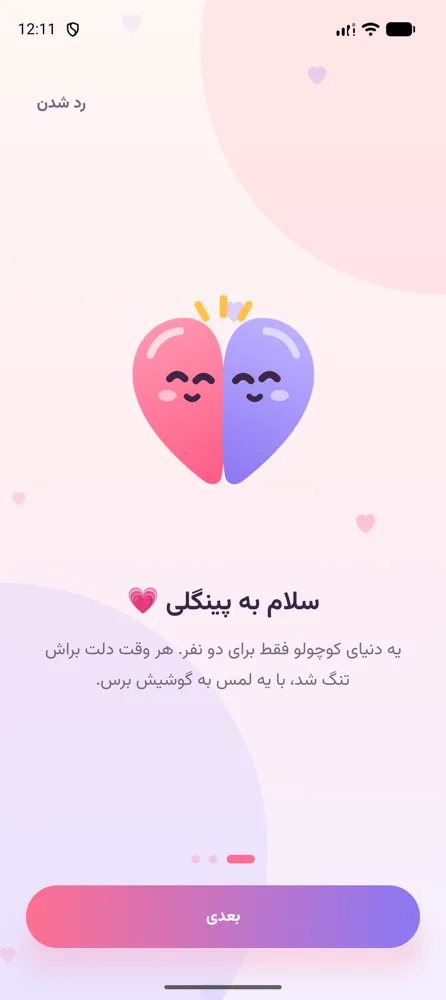
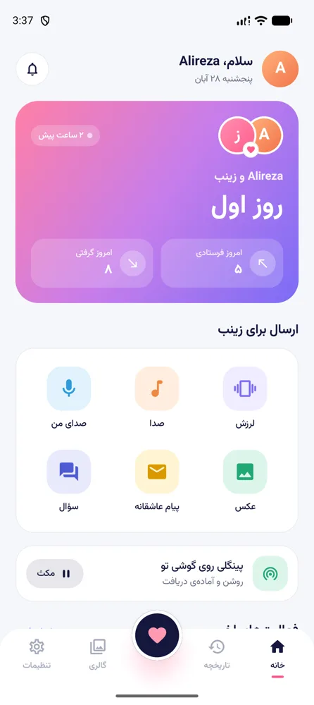
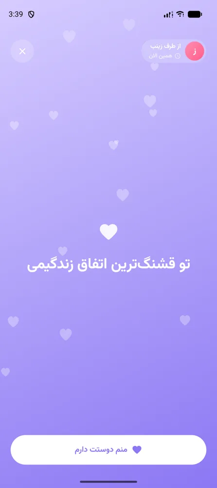
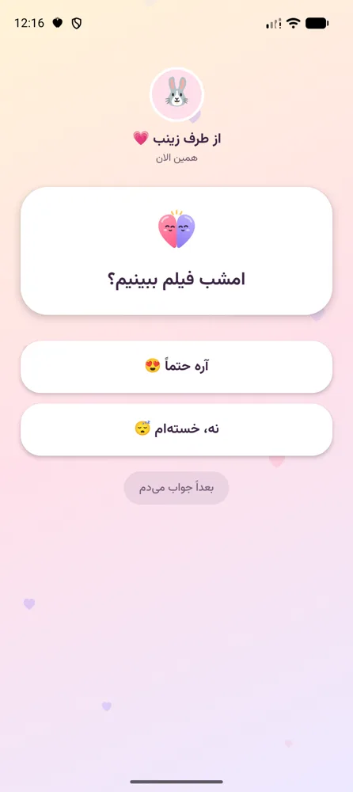
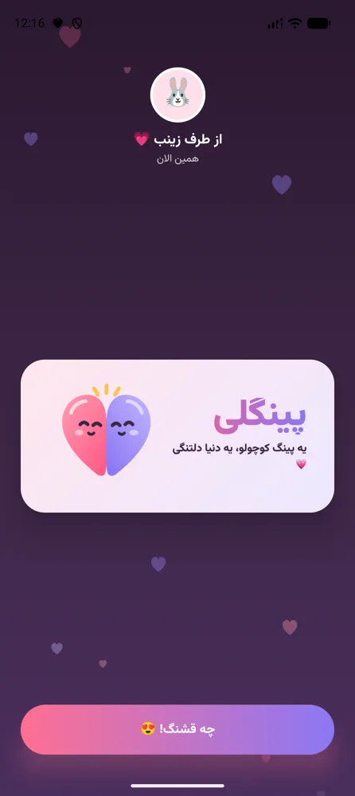
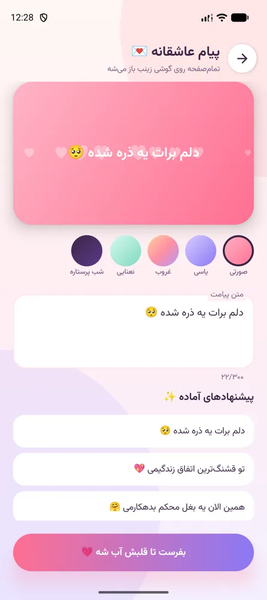
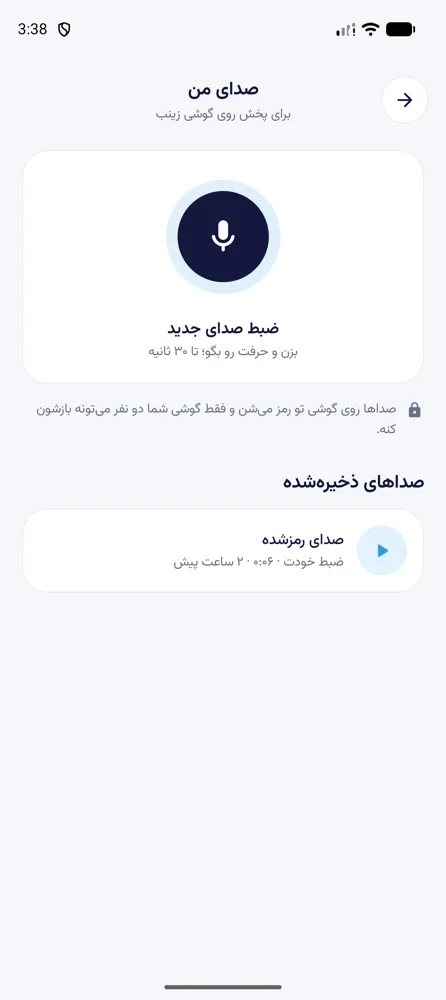
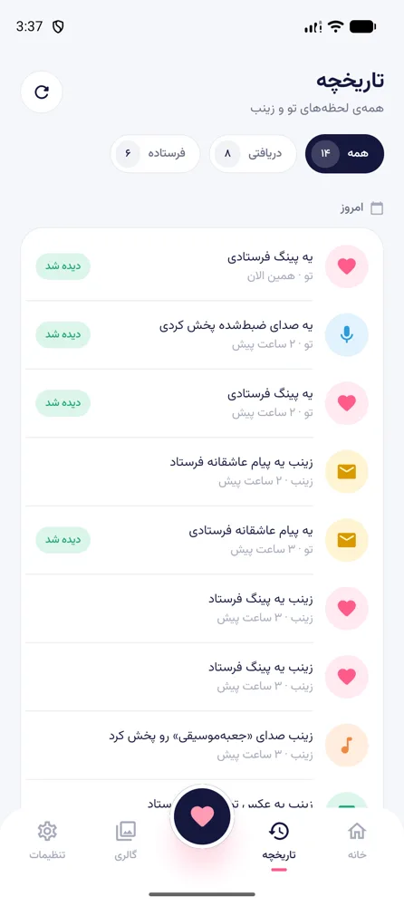
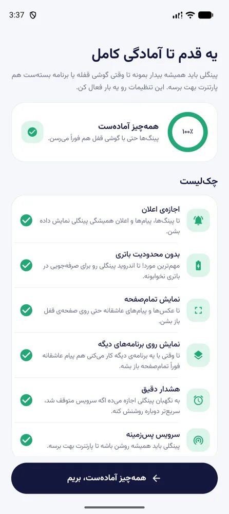
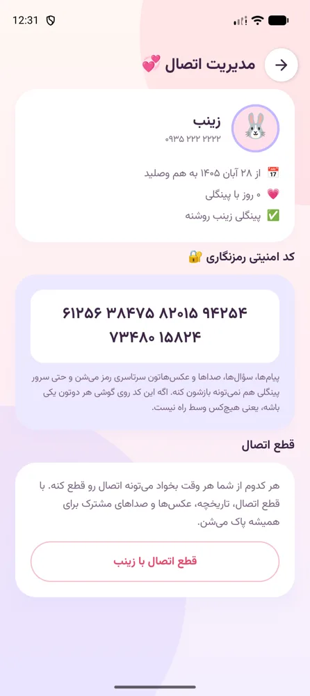

# Pingly · پینگلی


**Pingly** is a Persian (RTL) Android app for couples: two phones, one tiny private channel.
Partners connect by phone number — and only once *both* agree — then reach each other's phone
with playful actions: a heartbeat vibration, a cute sound, their own recorded voice, a
full-screen photo or love note, or a question waiting for an answer. Even when the app is
closed and the screen is locked.

| | | | |
|---|---|---|---|
|  |  |  |  |
|  |  |  |  |
|  |  | | |

## Features

- **Phone + OTP login** (SMS.ir), Persian or Latin digits, one phone per account
- **Consent-first pairing** — invite a number; nothing connects until the invitee taps *accept*
- **Remote actions**: ping 💗, six vibration patterns, eight original sounds, personal voice
  notes, full-screen photos, full-screen love notes (5 styles), multiple-choice or free-answer
  questions — with delivered / seen / answered receipts
- **Couple dashboard**: avatars, days-together counter, live presence, recent activity
- **Shared gallery and voice library**, **history** with Jalali dates
- **Privacy controls**: the receiver chooses which actions the partner may trigger (enforced
  by the server), end-to-end encryption with a verifiable safety code, unpair (erases shared
  data), permanent account deletion
- **Maximum background persistence** within Android's rules, and a single explicit **Pause**
  button as the only intentional off switch (see [android/README.md](android/README.md))
- A complete brand: logo, adaptive/themed icon, mascots, palette, typography and sound pack

## Repository

| Path        | What it is |
|-------------|------------|
| `android/`  | The app — Kotlin, Jetpack Compose, Material 3 ([details](android/README.md)) |
| `server/`   | Backend — Node 24 + TypeScript, Fastify, WebSocket, SQLite ([details](server/README.md)) |
| `branding/` | Logo, icon, brand guide, and generators for icons and sounds ([details](branding/README.md)) |
| `docs/`     | Screenshots |

## How it fits together

```
 Phone A (Pingly)                    pingly.byalireza.ir                      Phone B (Pingly)
 ┌──────────────────┐   HTTPS REST   ┌──────────────────────────┐  WebSocket  ┌──────────────────┐
 │ UI → EventRepo   │ ─────────────▶ │ Fastify API  · SQLite    │ ──────────▶ │ Foreground svc   │
 │ E2EE (AES-GCM)   │                │ consent + pause checks   │  push event │ → vibrate / play │
 │                  │ ◀───────────── │ realtime hub · media     │ ◀────────── │ → full-screen    │
 └──────────────────┘ status pushes  └──────────────────────────┘  ack/opened └──────────────────┘
```

The server relays ciphertext; only the two phones hold the keys.

## Deployment

The backend runs on Coolify as the `pingly` app (Dockerfile build from `server/`, persistent
volume at `/data`, auto-deploy on pushes touching `server/**`), at `https://pingly.byalireza.ir`.
Login codes go through SMS.ir (`SMSIR_API_KEY`, `SMSIR_TEMPLATE_ID`, `SMSIR_PARAMETER_NAME`).
