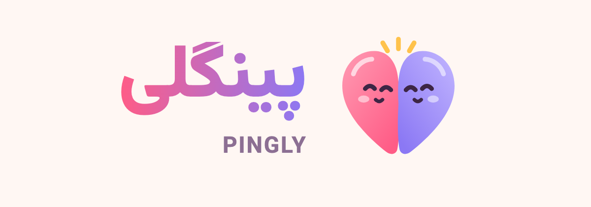
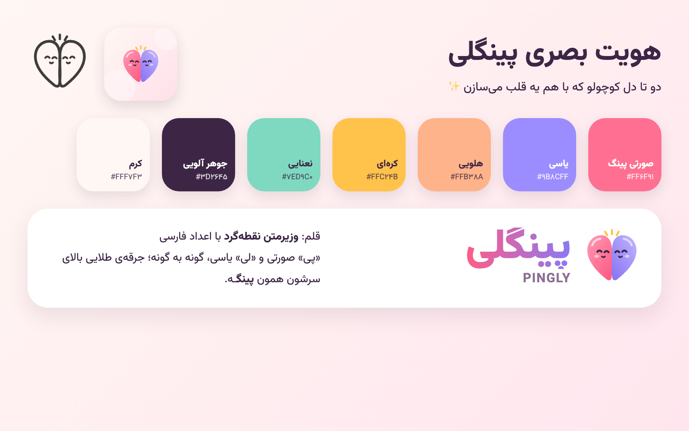

# Pingly brand guide · هویت بصری پینگلی

## The mark — «پی» و «لی»

Pingly's mark is two little beings, **Pi** (pink) and **Ly** (lilac), leaning cheek to cheek.
Each is half of a heart with its own rounded body, so you read *two people* first and *one
heart* second — that is the whole product in one picture. Their eyes are closed in a happy
"^^" squint and their cheeks are blushing.

The three golden strokes above the heart's cleft are the **ping**: the instant spark that
travels from one phone to the other. It is also the only part of the mark that isn't pastel,
so it is what the eye lands on at launcher size.

| File | Use |
|------|-----|
| `logo/pingly-mark.svg` | The mark alone, transparent background |
| `logo/pingly-app-icon.svg` | Full-bleed square icon on the 108-unit adaptive-icon canvas |
| `logo/pingly-icon-monochrome.svg` | Line-art version — Android 13+ themed icons, one-colour print |
| `exports/*.png` | Rendered from `brand-sheet.html` with headless Chrome |

The Android app uses vector-drawable ports of the same paths
(`ic_launcher_foreground`, `ic_launcher_monochrome`, `ic_pingly_mark`, `ic_stat_pingly`),
so the icon stays sharp at every density.

### Clear space and minimum size

- Keep clear space around the mark equal to the height of the ping burst.
- Below 24 px drop the faces and use the silhouette (`ic_stat_pingly`).
- Never recolour Pi and Ly to the same colour, rotate the mark, or add an outline.

## Palette

| Name | Persian | Hex | Role |
|------|---------|-----|------|
| Ping Pink | صورتی پینگ | `#FF6F91` | Primary, Pi, main actions |
| Lilac | یاسی | `#9B8CFF` | Secondary, Ly, partner |
| Peach | هلویی | `#FFB38A` | Warm accents, sounds |
| Butter | کره‌ای | `#FFC24B` | The ping spark, highlights |
| Mint | نعنایی | `#7ED9C0` | Success, "online" |
| Plum Ink | جوهر آلویی | `#3D2645` | Text, faces |
| Cream | کرم | `#FFF7F3` | Backgrounds |

Gradients always run pink → lilac (Pi → Ly).

## Typography

**Vazirmatn Round-Dots, Farsi-digits build** (`Vazirmatn-RD-FD`, SIL Open Font License,
by Saber Rastikerdar). Round dots make Persian text feel soft and friendly, and the FD build
renders every number with Persian digits without any conversion code.

- Wordmark «پینگلی»: Black, pink → lilac gradient
- Headings: Bold / Black
- Body: Regular / Medium

## Voice

Warm, playful, colloquial Persian (محاوره‌ای مودبانه) — the way a couple talks to each other:
«دلت براش تنگ شده؟ یه پینگ بفرست 💗». Errors are gentle and always say what to do next.

